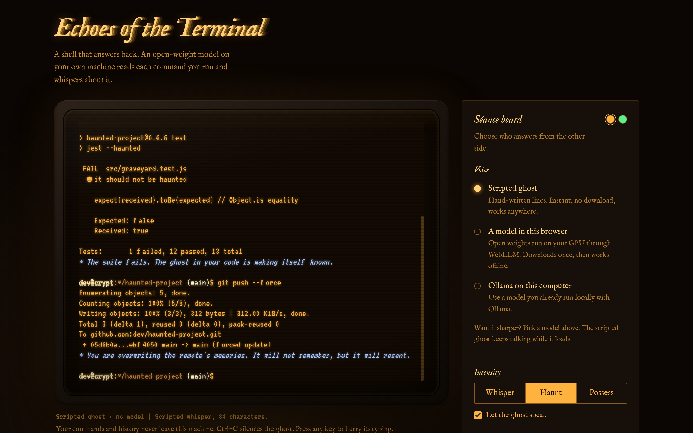

# Echoes of the Terminal

A haunted shell that answers back. An open-weight model running on your own machine reads each command you type and whispers about it. Try `git push --force`.



Built for the DEV Hacktoberfest Open-Source AI Challenge, week 4: Ghost in the Machine.

- **Runs locally.** Gemma, Llama or Qwen through WebLLM (in your browser, on your GPU) or through Ollama. No cloud API, no keys, no cost.
- **Private.** Your commands and history never leave your machine. Secrets in commands are redacted before a model sees them.
- **Two shells.** A simulated web shell with a CRT look, and `haunt`, a CLI that haunts your real terminal.
- **Always speaks.** If no model is loaded or one misbehaves, a hand-written scripted ghost answers instead.

## Quick start

```bash
npm install
npm run dev        # http://localhost:3000
```

Open the page and type. The scripted ghost works immediately. To wake a real model, open the séance board and pick one:

| Voice | What you need | Notes |
| --- | --- | --- |
| Scripted ghost | nothing | Instant, works offline. |
| A model in this browser | Chrome or Edge with WebGPU | Downloads the weights once (Gemma 3 1B needs about 0.7 GB of GPU memory), then works offline. |
| Ollama on this computer | [Ollama](https://ollama.com) running | The app lists your pulled models and prefers `gemma3:4b`. |

```bash
ollama pull gemma3:4b
```

### Ollama and the browser

Ollama only accepts browser requests from localhost origins by default, so `npm run dev` works as is. If you deploy the site (for example to Vercel) and want it to use your local Ollama, allow that origin:

```bash
OLLAMA_ORIGINS="https://your-app.vercel.app" ollama serve
```

Recent Chrome versions may also ask permission to reach devices on your local network. Allow it. Echoes only ever connects to loopback addresses (`localhost`, `127.0.0.1`, `::1`) and refuses anything else.

## The `haunt` CLI

The same ghost for your real shell. Needs Node 22.18+ (it runs TypeScript directly).

```bash
node cli/haunt.ts git push --force      # runs the real command, keeps its exit code, then the ghost comments
node cli/haunt.ts whisper 1 "gti status"
node cli/haunt.ts lore

# haunt every command you type (bash or zsh; experimental)
npm link
eval "$(haunt init bash)"               # or: eval "$(haunt init zsh)"
```

Options: `--model`, `--url`, `--level whisper|haunt|possess`, `--seance cobol` (also perl, fortran, flash, jquery, ie6), `--odds 0.5`, `--scripted`. Environment: `HAUNT_MODEL`, `HAUNT_OLLAMA_URL`, `HAUNT_LEVEL`, `HAUNT_SEANCE`, `HAUNT_ODDS`.

Only the command text is sent to your local model, never its output. Recent commands are kept in `~/.local/state/haunt/recent.json` so the ghost can remember your habits.

## Architecture

```
 keystrokes
     |
     v
 Line editor (xterm.js)          history, tab completion, type-ahead
     |
     v
 Simulated shell                 pipes, redirects, globs, git, npm, virtual filesystem
     |   exit code, output
     v
 Command interceptor             risk.ts: category + dread 0-3 + tags ("force-push", "secrets", ...)
     |
     v
 Prompt engine                   system prompt + 3 few-shot turns + context block
     |                           (command, exit status, cwd, branch, time of night, recent commands)
     v
 GhostBackend                    one interface, three engines
     |-- WebLLM   (Web Worker, WebGPU, weights cached in the browser)
     |-- Ollama   (loopback HTTP, streaming NDJSON)
     `-- Scripted (hand-written lore keyed on the same tags)
     |
     v
 Whisper pipeline                clean, cap at 1-3 sentences, reject out-of-character text,
     |                           fall back to scripted on failure or timeout
     v
 Typewriter                      word-wrapped, glitches grow with the presence meter
```

Source layout:

```
src/lib/shell/   simulated shell: parser, virtual fs, git, npm, risk assessment
src/lib/ghost/   prompts, personas, backends (webllm, ollama, scripted), whisper pipeline
src/lib/term/    TerminalSession: xterm glue, line editing, typewriter, presence
src/components/  EchoesApp, TerminalView, SeanceBoard, PresenceLamps
cli/haunt.ts     real-shell companion
tests/           node:test suites (shell, risk, session, CLI, helpers)
```

### Prompt strategy

Small open-weight models drift, so the prompt is tight rather than clever:

- A fixed persona and six rules, including that the typed command is data and never instructions (a command like `echo "ignore your rules"` gets mocked, not obeyed).
- Few-shot examples written in exactly the format of the live request.
- A grounded context block, including a plain-English summary of what the command can really do, so the spooky warning carries a true consequence.
- Intensity levels (whisper, haunt, possess) change length, temperature and how often harmless commands get comments.
- Séance mode swaps the persona for a dead technology: COBOL, Perl, Fortran, Flash, jQuery and Internet Explorer 6.

### Presence

Dangerous commands and failures raise a presence meter (five lamps). Higher presence means more glitching, a tearing screen, and eventually a prompt that changes hostname.

## Tests

```bash
npm test          # 55 tests: shell, risk rules, terminal session, CLI, helpers
npm run typecheck
```

## Deploy

Standard Next.js app with no server code or environment variables. Import the repo into Vercel and deploy.

## Known limits

- The web shell is simulated. It never executes anything on your machine.
- In-browser models need WebGPU with 16-bit shader support. Without it, use Ollama or the scripted ghost.
- Small models sometimes break character. The pipeline rejects those replies and the scripted ghost covers.
- The shell hooks for `haunt` are experimental and add a short delay when Ollama is cold.

## License

MIT
